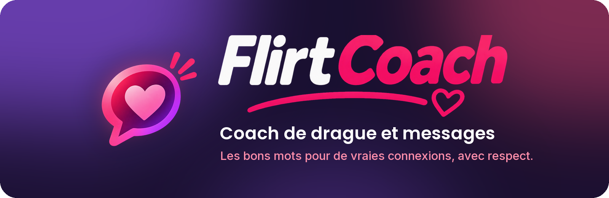
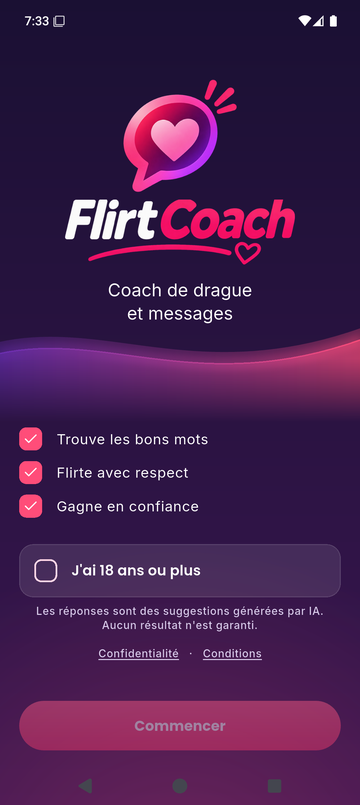
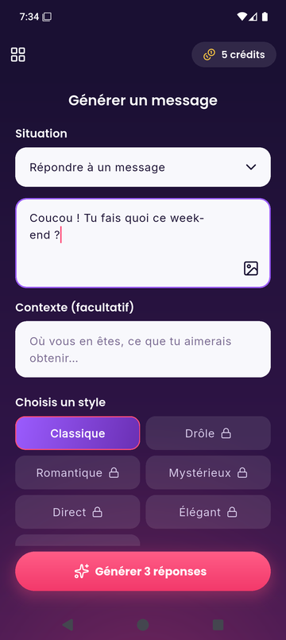
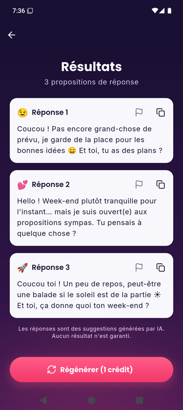
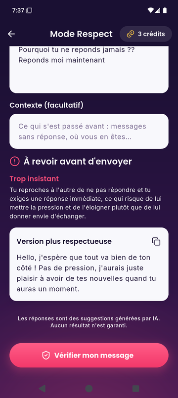
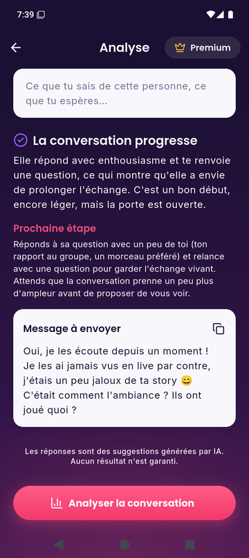
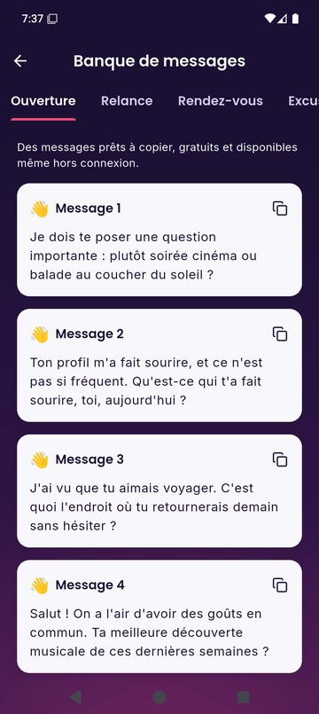
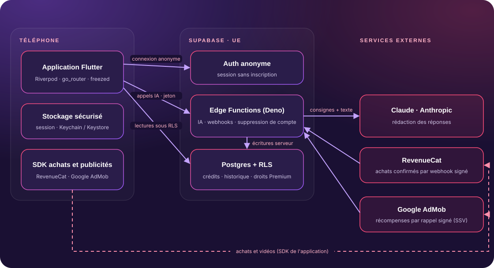

<div align="center">



<br>
<br>


-D97757?style=flat-square&logo=anthropic&logoColor=white)


**[À propos](#à-propos)** · **[Fonctionnalités](#fonctionnalités)** · **[Architecture](#architecture)** ·
**[Démarrage](#démarrage-rapide)** · **[Documentation](#documentation-détaillée)**

</div>

---

## Sommaire

1. [À propos](#à-propos)
2. [Fonctionnalités](#fonctionnalités)
3. [Aperçu](#aperçu)
4. [Modèle économique](#modèle-économique)
5. [Architecture](#architecture)
6. [Stack technique](#stack-technique)
7. [Démarrage rapide](#démarrage-rapide)
8. [Configuration](#configuration)
9. [Tests et qualité](#tests-et-qualité)
10. [Compilation et déploiement](#compilation-et-déploiement)
11. [Structure du dépôt](#structure-du-dépôt)
12. [Sécurité et confidentialité](#sécurité-et-confidentialité)
13. [Limites connues et prochaines étapes](#limites-connues-et-prochaines-étapes)
14. [Documentation détaillée](#documentation-détaillée)
15. [Licence](#licence)

## À propos

**Flirt Coach Pro** est une application mobile qui aide les adultes à écrire leurs messages de
séduction grâce à l'intelligence artificielle. L'utilisateur colle le message reçu, ou importe une
capture d'écran de la conversation, choisit une situation et un style, et reçoit **trois réponses
naturelles, prêtes à copier**.

Sa ligne est claire : **séduire avec respect**. Le coach refuse les demandes sexuellement
explicites, haineuses, insistantes après un refus ou manipulatrices, et le **Mode Respect** aide à
reformuler un message avant de l'envoyer.

| Flirt Coach Pro est | Flirt Coach Pro n'est pas |
|-----------------|------------------------|
| un coach bienveillant qui propose des mots | un outil de manipulation |
| transparent : les réponses sont des suggestions d'IA | une promesse de résultat |
| réservé aux adultes (18 ans et plus) | une application pour mineurs |
| respectueux de la personne en face | un générateur de contenu sexuel |

| En bref | |
|---|---|
| **Plateformes** | Android 7 et plus · iOS 13 et plus |
| **Langue** | interface en français ; réponses dans la langue de la conversation |
| **Compte** | anonyme, créé au premier lancement : ni nom, ni e-mail, ni mot de passe |
| **Version** | 1.0.0 terminée, en préparation de publication ([journal des modifications](CHANGELOG.md)) |

## Fonctionnalités

| Fonctionnalité | Gratuit | Premium |
|----------------|:-------:|:-------:|
| **3 réponses** à un message, pour 7 situations : répondre, premier message, flirter, relancer, avant un rendez-vous, s'excuser, rompre en douceur | 1 crédit | inclus |
| **7 styles** : Classique, Drôle, Romantique, Mystérieux, Direct, Élégant, Provocateur léger | Classique | tous |
| **Capture d'écran** : le coach lit la conversation et répond (image jamais conservée) | 2 crédits | inclus |
| **Mode Respect** : le message est-il insistant, sexualisé ou manipulateur ? Version corrigée proposée | 1 crédit | inclus |
| **Analyse de conversation** : dynamique, prochaine étape, idée de rendez-vous | — | inclus |
| **Banque de messages** : 40 messages en 5 catégories, consultable hors connexion | gratuite | gratuite |
| **Historique** des générations, copie et suppression | — | inclus |
| **Signalement** d'une réponse, aide intégrée, suppression du compte | oui | oui |
| Publicités | bannière discrète, vidéo facultative | aucune |

## Aperçu

<table align="center">
  <tr>
    <td align="center"><br><sub><b>Accueil 18+</b></sub></td>
    <td align="center"><br><sub><b>Générer un message</b></sub></td>
    <td align="center"><br><sub><b>Trois réponses</b></sub></td>
  </tr>
  <tr>
    <td align="center"><br><sub><b>Mode Respect</b></sub></td>
    <td align="center"><br><sub><b>Analyse de conversation</b></sub></td>
    <td align="center"><br><sub><b>Banque de messages</b></sub></td>
  </tr>
</table>

Le fonctionnement de chaque écran est décrit dans le [guide utilisateur](docs/guide/guide-utilisateur.md).

## Modèle économique

Les abonnements d'abord, les crédits ensuite, la publicité en complément.

| Offre | Contenu | Prix (TTC, fixé dans les stores) |
|-------|---------|----------------------------------|
| **Gratuit** | 5 crédits par jour, remis à 5 à minuit UTC (non cumulables) ; vidéo facultative : +2 crédits, 5 fois par jour | 0 € |
| **Packs de crédits** | 20, 50 ou 100 crédits, sans abonnement ni date d'expiration | 2,99 € · 5,99 € · 9,99 € |
| **Premium** | toutes les fonctionnalités, sans publicité, jusqu'à 100 générations par jour | 6,99 €/semaine · 12,99 €/mois · 49,99 €/an |

Les crédits, Premium et les récompenses sont accordés **uniquement par le serveur**, après
confirmation du store (via RevenueCat) ou d'AdMob : l'application ne peut pas se les attribuer.

## Architecture

<p align="center">
  
</p>

| Principe | Mise en œuvre |
|----------|---------------|
| **Aucun secret dans l'app** | elle ne contient que l'URL Supabase et la clé publique ; la clé IA et les secrets des webhooks restent sur le serveur |
| **Le serveur décide** | chaque fonction IA suit le même parcours : session → validation → âge → Premium → quotas et débit sous verrou → appel à Claude → enregistrement, ou remboursement en cas d'échec |
| **Données cloisonnées** | Row Level Security sur chaque table : un utilisateur ne voit que ses propres données |
| **Droits vérifiés** | achats confirmés par webhook RevenueCat (secret partagé) ; récompenses par rappel AdMob signé (ECDSA) |
| **Application structurée** | une fonctionnalité = `presentation` · `application` · `domain` · `data` ; état géré par Riverpod |

Détails : [architecture](docs/architecture.md) · [flux principaux](docs/system-design.md) ·
[modèle de données](docs/data-model.md) · [référence de l'API](docs/api-reference.md).

## Stack technique

| Couche | Technologies |
|--------|--------------|
| Application | Flutter 3.41 (Dart 3.11) · Riverpod 2.6 · go_router · freezed · `flutter_secure_storage` (Keychain / Keystore) |
| Serveur | Supabase : Postgres 17 avec RLS, authentification anonyme, 7 Edge Functions en Deno / TypeScript |
| Intelligence artificielle | Claude Opus 5.5 (Anthropic), sortie JSON imposée, appelé uniquement depuis le serveur |
| Achats | RevenueCat (Google Play, App Store) |
| Publicité | Google AdMob, consentement RGPD (UMP), vérification côté serveur (SSV) |
| Qualité | `flutter_test`, `integration_test`, pgTAP, `deno test`, GitHub Actions |
| Développement local | Docker Desktop (Supabase local) |

## Démarrage rapide

### Prérequis

| Outil | Version |
|-------|---------|
| Flutter | 3.41 ou plus |
| Docker Desktop | démarré |
| Supabase CLI | 2.121 ou plus |
| Android Studio | avec un émulateur Android 7 ou plus |
| Clé API Anthropic | — |

### Installation

**1. Démarrer la base de données locale.** Les migrations sont appliquées automatiquement (le
premier lancement télécharge les images Docker).

```powershell
supabase start
```

**2. Donner la clé IA au serveur local.** Copier `supabase/functions/.env.example` en
`supabase/functions/.env` et y renseigner `ANTHROPIC_API_KEY` (ce fichier n'est jamais versionné).
Puis, dans un terminal dédié :

```powershell
supabase functions serve --env-file supabase/functions/.env
```

**3. Configurer l'application.** Copier le modèle, puis y coller dans `SUPABASE_ANON_KEY` la clé
*publishable* affichée par `supabase status` :

```powershell
Copy-Item config/dev.example.json config/dev.json
```

**4. Lancer l'application** sur l'émulateur :

```powershell
flutter run --dart-define-from-file=config/dev.json
```

> **À savoir** — Sans `--dart-define-from-file`, l'application affiche « Configuration
> manquante » au lieu de démarrer. Si `supabase` ne trouve pas Docker dans PowerShell :
> `$env:Path = "$env:LOCALAPPDATA\Programs\DockerDesktop\resources\bin;$env:Path"`

## Configuration

### Application

Variables passées à la compilation par `--dart-define-from-file`. Les fichiers réels
(`config/dev.json`, `config/phone.json`, `config/prod.json`) ne sont pas versionnés ; leurs
modèles `config/*.example.json` le sont.

| Variable | Rôle |
|----------|------|
| `SUPABASE_URL` | adresse du serveur Supabase (local : `http://10.0.2.2:54321` depuis l'émulateur) |
| `SUPABASE_ANON_KEY` | clé publique Supabase (les données restent protégées par RLS) |
| `REVENUECAT_ANDROID_KEY`, `REVENUECAT_IOS_KEY` | clés publiques du SDK RevenueCat |
| `ADMOB_BANNER_ANDROID`, `ADMOB_REWARDED_ANDROID`, `ADMOB_BANNER_IOS`, `ADMOB_REWARDED_IOS` | blocs d'annonces (identifiants de test Google par défaut) |
| `LEGAL_PUBLISHER` | éditeur affiché dans les textes légaux |
| `SUPPORT_EMAIL` | adresse du bouton « Contacter le support » |

### Serveur

Secrets des Edge Functions : fichier `supabase/functions/.env` en local, `supabase secrets set`
sur le cloud.

| Secret | Rôle |
|--------|------|
| `ANTHROPIC_API_KEY` | clé de l'API Claude |
| `REVENUECAT_WEBHOOK_SECRET` | authentifie les webhooks d'achat |
| `REVENUECAT_SECRET_API_KEY` | efface aussi le client RevenueCat lors d'une suppression de compte |
| `REVENUECAT_ALLOW_SANDBOX` | `true` uniquement pendant les tests d'achat — à retirer avant publication |
| `ADMOB_AD_UNIT_IDS` | blocs « récompensée » autorisés à créditer |

Détail de chaque variable et constantes métier : [configuration](docs/configuration.md).

## Tests et qualité

| Suite | Commande | Couverture | Tests |
|-------|----------|------------|------:|
| Application | `flutter test` | logique, écrans, erreurs, accessibilité (contrastes, libellés) | 117 |
| Base de données | `supabase test db` | RLS, crédits, quotas, achats, récompenses, transferts, signalements | 110 |
| Edge Functions | `deno test` (via Docker, voir [exploitation](docs/operations.md#tests-des-edge-functions)) | validation, refus, remboursements, webhooks, signatures | 51 |
| Bout en bout | `flutter drive … --target=integration_test/parcours_test.dart` | parcours complet sur appareil et mesure de fluidité | 1 |
| Analyse statique | `flutter analyze` | règles de lint du projet | — |

**Intégration continue** (`.github/workflows/ci.yml`) à chaque envoi sur `main` et chaque demande
de fusion : génération de code, format, analyse et tests de l'application ; format, lint, typage et
tests des 7 Edge Functions ; migrations rejouées et tests de la base.

**Performance mesurée** : démarrage à froid en 1,75 à 1,90 s (budget 2 s), construction d'une
image en 2,1 ms en moyenne, APK de 24,4 Mo par architecture. Détails :
[performance](docs/performance.md) · [stratégie de tests](docs/qa/test-plan.md).

## Compilation et déploiement

| Cible | Commande |
|-------|----------|
| APK pour téléphone (serveur cloud) | `flutter build apk --release --target-platform android-arm,android-arm64 --dart-define-from-file=config/prod.json` |
| APK pour téléphone (serveur local, même Wi-Fi) | `flutter build apk --profile --target-platform android-arm,android-arm64 --dart-define-from-file=config/phone.json` |
| Google Play | `flutter build appbundle --release --dart-define-from-file=config/prod.json -PadmobAppId=<id AdMob Android>` |
| App Store | `flutter build ipa --dart-define-from-file=config/prod.json` (sur macOS) |
| Base et fonctions sur le cloud | `powershell -ExecutionPolicy Bypass -File scripts\deploy-cloud.ps1` |

- Le script de déploiement vérifie le projet, applique les nouvelles migrations après
  confirmation, déploie les 7 Edge Functions et liste les secrets présents.
- Une version publiable exige la clé de signature et les comptes des stores : voir les
  [tâches manuelles](docs/manual-tasks.md).
- Exploitation courante (secrets, surveillance, incidents) : [exploitation](docs/operations.md).

## Structure du dépôt

```text
lib/
├── core/                   configuration, thème, erreurs, client Supabase, stockage sécurisé
├── features/               une fonctionnalité par dossier : presentation · application · domain · data
│   ├── generation/  respect/  analysis/  message_bank/  history/
│   └── purchases/  ads/  credits/  report/  settings/  legal/  …
└── l10n/app_fr.arb         tous les textes de l'interface
assets/                     logos, polices, textes légaux, aide intégrée
supabase/
├── migrations/             schéma, RLS et fonctions SQL, rejouables depuis zéro
├── functions/              Edge Functions Deno : IA, webhooks, suppression de compte
└── tests/                  tests pgTAP
test/  integration_test/    tests de l'application
config/*.example.json       modèles de configuration
scripts/deploy-cloud.ps1    déploiement Supabase cloud
docs/                       documentation détaillée
```

## Sécurité et confidentialité

- **Aucun secret** dans l'application ni dans le dépôt ; les fichiers de configuration réels sont
  exclus du versionnement.
- **Session** stockée dans le Keychain (iOS) ou le Keystore (Android).
- **Row Level Security** sur toutes les tables ; les opérations sensibles passent par des
  fonctions SQL réservées au serveur.
- **Quotas** d'appels IA comptés avant l'appel : 10 par minute et 100 par jour par compte.
- **Captures d'écran** jamais conservées ni journalisées ; journaux serveur sans contenu
  utilisateur.
- **Suppression du compte** depuis l'application : toutes les données du compte sont effacées de
  la base, en cascade.
- **Âge** : confirmation 18+ obligatoire, vérifiée par le serveur avant chaque génération.

Menaces étudiées et protections : [sécurité](docs/security.md).

## Limites connues et prochaines étapes

| Sujet | État |
|-------|------|
| Crédits achetés et historique | liés à l'installation, perdus en cas de réinstallation (l'abonnement Premium, lui, se récupère avec « Restaurer mes achats ») |
| Création de comptes anonymes en série | décision en attente ([tâche 17](docs/manual-tasks.md#17-protection-contre-la-création-de-comptes-en-série)) |
| Version iOS | à compiler sur macOS ou en CI macOS |
| Publication | comptes stores, RevenueCat, AdMob, signature, textes légaux relus : [tâches manuelles](docs/manual-tasks.md) |

## Documentation détaillée

| Public | Document | Contenu |
|--------|----------|---------|
| Produit | [Besoins utilisateurs](docs/product/user-stories.md) | personas, user stories et critères d'acceptation |
| | [Parcours et écrans](docs/design/flows.md) | enchaînement des écrans |
| | [Design system](docs/design/design-system.md) | couleurs, typographie, composants du kit néon |
| | [Charte éditoriale](docs/style-guide.md) | ton, vocabulaire, règles d'écriture |
| Utilisateurs | [Guide utilisateur](docs/guide/guide-utilisateur.md) | chaque fonctionnalité, illustrée |
| | [FAQ et support](docs/support/faq.md) | questions fréquentes, diagnostic, réponses types |
| Technique | [Architecture](docs/architecture.md) | couches, navigation, erreurs, hors connexion |
| | [Flux principaux](docs/system-design.md) | premier lancement, génération, achat, vidéo, suppression, restauration |
| | [Modèle de données](docs/data-model.md) | tables, RLS, fonctions SQL, conservation |
| | [Référence de l'API](docs/api-reference.md) | Edge Functions, webhooks, codes d'erreur |
| | [Configuration](docs/configuration.md) | variables de l'app, secrets, constantes métier |
| Qualité | [Stratégie de tests](docs/qa/test-plan.md) · [Sécurité](docs/security.md) · [Performance](docs/performance.md) · [Risques](docs/risks.md) | tests, menaces, mesures, risques |
| Exploitation | [Exploitation](docs/operations.md) | déploiement, secrets, surveillance, incidents |
| | [Tâches manuelles](docs/manual-tasks.md) | comptes, contrats, signatures, décisions |
| | [Fiche store](docs/store/fiche-store.md) | textes Google Play et App Store ; visuels Google Play dans `docs/store/visuels/` |
| Légal | [Politique de confidentialité](https://kelenix.github.io/Flirt-Coach/confidentialite.html) · [Conditions d'utilisation](https://kelenix.github.io/Flirt-Coach/conditions.html) | versions en ligne des textes de l'app |
| Suivi | [Journal des modifications](CHANGELOG.md) · [Décisions](DECISION_LOG.md) · [État du projet](PROJECT_STATE.md) | versions, choix techniques, avancement |

## Licence

Logiciel propriétaire. © 2026 Flirt Coach Pro — tous droits réservés.
