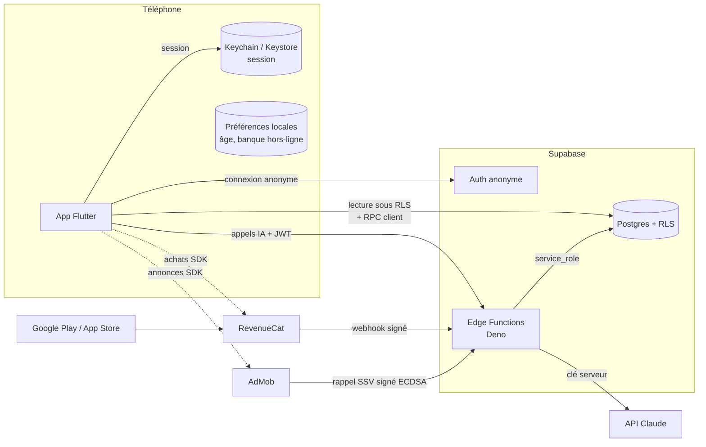
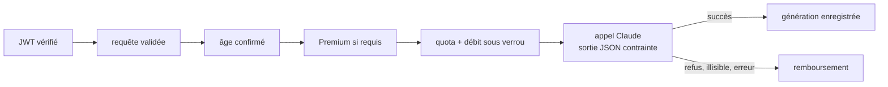

# Architecture

Ce document décrit l'architecture **telle qu'implémentée** (version 1.0.0). Les raisons des choix
sont dans [`DECISION_LOG.md`](../DECISION_LOG.md) (références ADR entre parenthèses).

## Vue d'ensemble



**Trois règles structurantes**

1. **Le serveur fait foi.** Crédits, droits Premium, récompenses et quotas ne sont modifiés que
   par le serveur (Edge Functions et fonctions SQL `security definer`). L'app relit son
   portefeuille, elle ne l'écrit jamais (ADR-005, ADR-017, ADR-025).
2. **Aucun secret dans l'app.** Elle ne connaît que l'URL Supabase et la clé *publishable*.
   La clé IA et `service_role` restent sur le serveur (ADR-003).
3. **RLS partout.** Le client lit ses propres lignes ; aucune table n'accepte d'écriture directe.

## Application Flutter

### Couches

```
lib/
├── main.dart              démarrage : configuration, barres système, Supabase, préférences
├── app.dart               MaterialApp.router, thème, l10n, relecture du portefeuille au retour
├── core/                  config (Env), thème (tokens, icônes), erreurs (Failure),
│                          client Supabase (garde, délais), état (GuardedAction), stockage
├── routing/               go_router + garde d'accès
├── shared/widgets/        composants du kit de marque (boutons, cartes, fond, logo…)
├── l10n/                  textes de l'interface : app_fr.arb (source), app_en.arb, app_de.arb ;
│                          langue choisie par core/l10n/app_language.dart (ADR-034)
└── features/<feature>/
    ├── presentation/      écrans et widgets (aucune logique métier)
    ├── application/       contrôleurs Riverpod (AsyncNotifier)
    ├── domain/            entités (freezed) et interfaces de dépôt
    └── data/              implémentations Supabase / SDK
```

Une feature ne crée que les couches dont elle a besoin. Le **domaine** ne dépend ni de Supabase
ni de Flutter : les tests remplacent chaque dépôt par un faux (`test/helpers/test_app.dart`).

| Feature | Rôle |
|---------|------|
| `onboarding` | accueil 18+, création de la session anonyme, garde d'accès |
| `generation` | écran Générer, situations, styles, capture, Résultats |
| `respect` | Mode Respect |
| `analysis` | analyse de conversation (Premium) |
| `message_bank` | banque de messages, copie locale hors-ligne |
| `history` | historique Premium, pagination, suppression |
| `credits` | portefeuille (crédits du jour, bonus, Premium), pastille |
| `purchases` | paywall, RevenueCat, offre annuelle à J+3 |
| `ads` | consentement UMP, bannière, vidéo récompensée |
| `report` | signalement d'une réponse |
| `settings` | réglages, suppression du compte |
| `legal` | textes légaux et aide embarqués |
| `menu`, `auth` | menu des fonctionnalités, session |

### Navigation

| Route | Écran | Accès |
|-------|-------|-------|
| `/welcome` | Accueil 18+ | sans session |
| `/legal/privacy`, `/legal/terms` | Textes légaux | toujours, même avant l'âge |
| `/` | Générer | âge confirmé + session |
| `/results` | 3 propositions | idem |
| `/respect`, `/analysis`, `/bank`, `/history` | fonctionnalités | idem |
| `/paywall` (`?offer=annual`) | offres Premium et packs | idem |
| `/settings`, `/help` | réglages, aide | idem |

Une **garde unique** (`appRouterProvider`) renvoie vers `/welcome` tant que l'âge n'est pas
confirmé ou qu'aucune session n'existe. Les écrans Premium ne sont pas bloqués par la route :
un utilisateur gratuit voit un écran « Réservé à Premium » ; la vraie protection est serveur.

### Gestion d'état

- Riverpod sans génération de code ; `AsyncNotifier` + `AsyncValue` pour tout l'asynchrone.
- Les actions (générer, vérifier, acheter, regarder une vidéo, supprimer le compte) passent par le
  mixin `GuardedAction` : état de chargement, contrôleur gardé en vie pendant l'appel, **double tap
  ignoré** (ADR-025).
- Le portefeuille (`walletProvider`) est relu au démarrage, après chaque action, au retour de
  l'app au premier plan et après la création d'une session.

### Erreurs

Toute erreur devient un `Failure` typé (réseau, crédits insuffisants, Premium requis, limite du
jour, limite par minute, IA indisponible, capture illisible…) traduit en message clair. Aucun
message technique n'est affiché. Délais maximaux : 20 s par appel, 70 s pour un appel IA.

### Hors-ligne

La génération exige le réseau. Hors-ligne, Générer, Mode Respect et Analyse affichent « Pas de
connexion. Vérifie ton réseau et réessaie. » et gardent leur bouton principal ; la Banque et
l'Historique proposent un bouton « Réessayer ». Aucun débit sans réponse du serveur. Exception :
la **banque de messages** reste consultable grâce à la dernière copie locale (ADR-022).

## Serveur (Supabase)

### Edge Functions

| Fonction | Appelée par | Authentification | Rôle |
|----------|-------------|------------------|------|
| `generate` | app | JWT utilisateur | 3 réponses pour une situation |
| `screenshot-reply` | app | JWT | 3 réponses à partir d'une capture |
| `respect-check` | app | JWT | verdict Respect + alternative |
| `conversation-analysis` | app | JWT (Premium) | dynamique, conseil, rendez-vous |
| `delete-account` | app | JWT | suppression définitive du compte |
| `revenuecat-webhook` | RevenueCat | secret partagé | droits Premium, crédits achetés |
| `admob-ssv` | Google AdMob | signature ECDSA | crédits de vidéo récompensée |

Les quatre fonctions IA partagent un même socle (`_shared/ai_endpoint.ts`) :



Le modèle est `claude-opus-5-5` (effort bas, sortie au format JSON imposé, repli serveur
automatique) ; consignes et données utilisateur sont séparées par balises (ADR-014, ADR-016).

### Base de données

Schéma, règles d'accès et fonctions SQL : [`data-model.md`](data-model.md). Contrats des appels :
[`api-reference.md`](api-reference.md).

## Capacités natives et permissions

| Besoin | Paquet | Permission |
|--------|--------|------------|
| Session sécurisée | `flutter_secure_storage` | aucune |
| Capture d'écran | `image_picker` (sélecteur système) | aucune permission permanente sur la galerie |
| Achats | `purchases_flutter` | facturation du store |
| Publicités | `google_mobile_ads` | Internet ; consentement UMP (RGPD) |
| Liens externes | `url_launcher` | aucune |

Le manifeste Android du projet ne déclare que `INTERNET`. Les SDK ajoutent au manifeste final :
`ACCESS_NETWORK_STATE`, `AD_ID`, `ACCESS_ADSERVICES_AD_ID`, `ACCESS_ADSERVICES_ATTRIBUTION`,
`ACCESS_ADSERVICES_TOPICS` (publicité), `BILLING` (achats), `WAKE_LOCK` et `FOREGROUND_SERVICE`.
L'identifiant publicitaire (`AD_ID`) doit être déclaré dans la Play Console. Aucune permission
caméra, micro, contacts, localisation ni notification.

## Environnements

| Environnement | Serveur | Configuration app |
|---------------|---------|-------------------|
| Développement | Supabase local (Docker) | `config/dev.json`, `config/phone.json` |
| Cloud (test puis production) | projet Supabase UE | `config/prod.json` |

Pas de *flavors* natifs : un seul identifiant d'application (ADR-011). Détail des variables :
[`configuration.md`](configuration.md).
