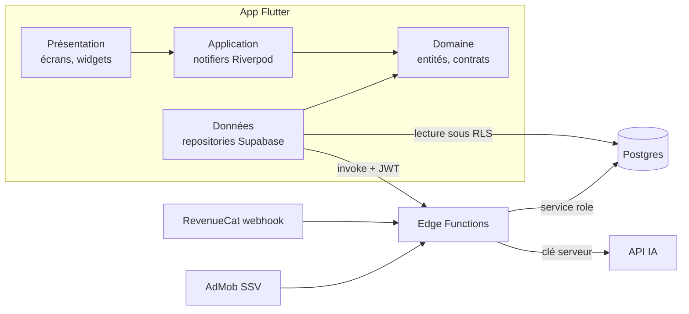

# Architecture — Flirt Coach

> Phase 3 — Mobile Architect. Décisions détaillées : `DECISION_LOG.md`.

## Vue d'ensemble



**Règle centrale** : l'app lit ses données sous RLS, mais toute écriture sensible (crédits,
droits Premium, générations) passe par une Edge Function. La clé IA et la clé `service_role`
ne quittent jamais le serveur.

## Structure du code

```
lib/
├── main.dart            # bootstrap (Supabase, préférences), ProviderScope
├── app.dart             # MaterialApp.router, thème, l10n
├── core/                # config, thème, erreurs, client Supabase, stockage sécurisé
├── routing/             # go_router + garde d'accès
├── l10n/                # app_fr.arb (source des textes)
├── shared/              # widgets réutilisables (logo, boutons, fond dégradé)
└── features/<feature>/
    ├── presentation/    # écrans, widgets
    ├── application/     # notifiers
    ├── domain/          # entités freezed, interfaces de repository
    └── data/            # implémentations Supabase
supabase/
├── migrations/          # schéma + RLS, rejouables depuis zéro
├── functions/           # Edge Functions (Deno/TypeScript)
└── seed.sql
```

Une feature ne crée que les couches dont elle a besoin (pas de dossiers vides).

## Navigation (go_router)

| Route | Écran | Accès |
|-------|-------|-------|
| `/welcome` | Accueil 18+ | toujours |
| `/` | Générer (accueil) | après confirmation d'âge + session |
| `/results` | 3 propositions | idem |
| `/screenshot`, `/respect`, `/analysis`, `/bank`, `/history` | fonctionnalités | idem (+ Premium vérifié serveur) |
| `/paywall` | offres | idem |
| `/settings`, `/legal/:doc` | réglages, textes légaux | `/legal` accessible dès `/welcome` |

Garde unique : sans confirmation d'âge ou sans session → `/welcome`. Les écrans Premium ne sont
pas protégés par la route (un gratuit voit l'écran verrouillé) ; la protection réelle est serveur.

## Gestion d'état

Riverpod, sans génération de code. `AsyncNotifier` + `AsyncValue` pour tout l'asynchrone ;
providers par feature ; dépendances injectées par providers (remplaçables en test).
Sources de vérité : session → Supabase Auth ; crédits et Premium → serveur (relus après chaque
action) ; confirmation d'âge → serveur, avec copie locale pour le démarrage hors-ligne.

## Hors-ligne

Pas de mode hors-ligne fonctionnel : la génération exige le réseau. L'app détecte l'échec
réseau, affiche un état d'erreur avec « Réessayer », et ne débite jamais sans réponse du
serveur. Seule la banque de messages est mise en cache pour consultation hors-ligne (Inc-8).

## Configuration et secrets

| Valeur | Où | Remarque |
|--------|----|----------|
| `SUPABASE_URL`, `SUPABASE_ANON_KEY` | `--dart-define-from-file=config/<env>.json` | publiques par nature, protégées par RLS |
| clé IA, `service_role`, secrets webhook | secrets Supabase (Edge Functions) | jamais dans l'app ni le dépôt |
| jeton de session | Keychain / Keystore (`flutter_secure_storage`) | pas dans les préférences |

Environnements : `config/dev.json` (Supabase local Docker) et `config/prod.json` (cloud), non
versionnés ; modèle dans `config/dev.example.json`. Pas de flavors natifs tant qu'un seul
identifiant d'application suffit (ADR-011).

## Capacités natives et permissions

| Besoin | Plugin | Permission |
|--------|--------|-----------|
| Choisir une capture | `image_picker` (sélecteur système) | aucune permission permanente |
| Achats | `purchases_flutter` | facturation |
| Publicités | `google_mobile_ads` | Internet, identifiant pub (consentement UMP/ATT) |
| Session | `flutter_secure_storage` | aucune |

Aucune permission caméra, micro, contacts, localisation ni notification en V1.
