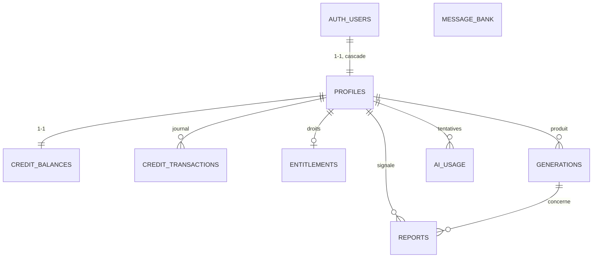

# Modèle de données

Base Postgres (Supabase), schéma `public`. Source de vérité : les migrations de
`supabase/migrations/`, rejouables depuis zéro (`supabase db reset`). Tests : `supabase/tests/`.

## Schéma

Toutes les tables liées à un utilisateur sont supprimées en **cascade** depuis `auth.users` :
supprimer le compte efface tout.

## Tables

| Table | Colonnes principales | Rôle |
|-------|----------------------|------|
| `profiles` | `id` (= `auth.users.id`), `age_confirmed_at`, `created_at`, `updated_at` | compte ; créé automatiquement à l'inscription |
| `credit_balances` | `user_id`, `daily_credits` (0–5), `daily_reset_on` (date UTC), `bonus_credits` (≥ 0), `updated_at` | solde courant ; remise à 5 au premier accès d'un nouveau jour |
| `credit_transactions` | `id`, `user_id`, `amount` (≠ 0), `kind`, `reference`, `created_at` | journal immuable des mouvements ; `reference` unique pour les achats et récompenses (anti-rejeu) |
| `entitlements` | `user_id`, `is_premium`, `product_id`, `expires_at`, `updated_at` | droits Premium, écrits uniquement par le webhook RevenueCat |
| `generations` | `id`, `user_id`, `kind`, `style`, `input_text` (≤ 4000), `context_text` (≤ 1000), `output` (jsonb), `created_at`, `deleted_at` | historique ; `input_text` vide pour une capture (jamais stockée) ; une entrée supprimée est vidée et marquée `deleted_at` |
| `ai_usage` | `id`, `user_id`, `reference`, `created_at` | chaque tentative d'appel IA, pour les quotas (10/min, 100/jour) |
| `message_bank` | `id`, `category`, `body` (≤ 400), `sort_order` | banque de messages (contenu statique, 40 lignes) |
| `reports` | `id`, `user_id`, `generation_id`, `reported_text`, `reason`, `created_at` | signalements ; texte copié, unique par couple (génération, texte), donc au plus 3 par génération |

### Types énumérés

| Type | Valeurs |
|------|---------|
| `generation_kind` | `reply`, `opener`, `flirt`, `follow_up`, `pre_date`, `apology`, `soft_breakup`, `screenshot`, `respect_check`, `conversation_analysis` |
| `message_style` | `classic`, `funny`, `romantic`, `mysterious`, `direct`, `elegant`, `playful_bold` |
| `credit_kind` | `daily_use`, `bonus_use`, `refund`, `purchase`, `ad_reward`, `purchase_refund` |
| `bank_category` | `opener`, `follow_up`, `date`, `apology`, `soft_breakup` |
| `report_reason` | `offensive`, `sexual`, `harassment`, `manipulative`, `other` |

### Contenu de `generations.output`

| `kind` | Forme |
|--------|-------|
| situations, `screenshot` | `{"proposals": ["…", "…", "…"]}` |
| `respect_check` | `{"isRespectful": bool, "issues": [{"category", "explanation"}], "alternative": "…" \| null}` |
| `conversation_analysis` | `{"momentum", "summary", "nextStep", "suggestedMessage", "dateSuggestion"}` |
| entrée supprimée | `{}` |

## Règles d'accès (RLS)

La RLS est active sur **toutes** les tables. Aucune table n'accepte d'écriture directe du client.

| Table | Lecture par l'utilisateur connecté | Écriture |
|-------|-----------------------------------|----------|
| `profiles` | sa ligne | trigger à l'inscription ; `confirm_age()` |
| `credit_balances`, `credit_transactions`, `entitlements` | ses lignes | fonctions serveur uniquement |
| `generations` | ses lignes non supprimées, **seulement en Premium** | Edge Functions ; `delete_generation()` |
| `ai_usage`, `reports` | aucune | fonctions serveur uniquement |
| `message_bank` | tout (connecté) | migrations |

Un visiteur sans session (`anon`) ne lit rien.

## Fonctions SQL

Toutes, sauf les constantes (simples fonctions SQL immuables), sont `security definer` avec
`search_path` vide et noms qualifiés.

### Appelables par l'app (rôle `authenticated`, agissent sur `auth.uid()` uniquement)

| Fonction | Rôle |
|----------|------|
| `confirm_age()` | enregistre la déclaration 18+ |
| `get_wallet()` | portefeuille de l'appelant : crédits du jour, bonus, Premium, vidéos restantes |
| `delete_generation(id)` | vide une entrée d'historique (texte, contexte, réponses) et la marque supprimée |
| `report_generation(id, texte, motif)` | signale un texte réellement produit par une de ses générations ; 20 par 24 h glissantes |

### Réservées au serveur (`service_role`)

| Fonction | Rôle |
|----------|------|
| `spend_credits(user, coût, référence)` | verrouille le solde, applique les quotas (10/min, 100/jour), enregistre la tentative, débite le jour puis le bonus (rien pour Premium) |
| `refund_credits(user, jour, bonus, référence)` | rend un débit (refus, capture illisible, erreur) |
| `grant_credits(user, montant, type, référence)` | crédite un achat ou une récompense, idempotent |
| `revoke_credits(user, montant, référence)` | reprend les crédits d'un pack remboursé (au plus le solde bonus), idempotent |
| `set_premium(user, actif, produit, échéance, forcer)` | met à jour le droit Premium ; ignore un événement plus ancien sauf remboursement |
| `transfer_premium(anciens, nouveaux)` | déplace un droit Premium actif des anciens comptes vers les nouveaux (abonnement restauré sur une autre installation) |
| `claim_ad_reward(user, transaction)` | +2 crédits par vidéo vue, 5 par jour, refusé aux Premium |
| `wallet_of(user)`, `is_premium(user)`, `lock_balance(user)` | lectures et verrou internes |

Constantes : `daily_credit_allowance()` = 5, `premium_daily_limit()` = 100,
`ai_rate_limit_per_minute()` = 10, `ad_reward_daily_limit()` = 5, `ad_reward_credits()` = 2.

## Conservation des données

| Donnée | Durée |
|--------|-------|
| Captures d'écran | jamais stockées (ADR-006) |
| Historique | contenu effacé quand l'utilisateur supprime une entrée ; la ligne vidée (type, style, date) reste jusqu'à la suppression du compte |
| Signalements | jusqu'à la suppression du compte ; ils gardent la copie du texte signalé même si l'entrée d'historique est supprimée, et l'utilisateur ne peut pas les effacer lui-même |
| Solde et mouvements de crédits | jusqu'à la suppression du compte |
| Tentatives d'appel IA (`ai_usage`) | jusqu'à suppression du compte (purge périodique possible, non automatisée en 1.0) |

## Index

`credit_transactions (user_id, created_at desc)` · `credit_transactions (reference)` unique pour
achats et récompenses · `generations (user_id, created_at desc)` · `ai_usage (user_id, created_at desc)`
· `reports (created_at desc)` · `message_bank (category, sort_order)` unique · `reports (generation_id, reported_text)` unique.

## Faire évoluer le schéma

1. Créer une migration horodatée : `supabase migration new <nom>`.
2. L'écrire de façon à pouvoir la rejouer depuis zéro ; ajouter ou adapter un test dans
   `supabase/tests/`.
3. `supabase migration up` puis `supabase test db` en local.
4. Déployer : `scripts/deploy-cloud.ps1` (confirmation demandée avant d'appliquer).

Ne jamais modifier une migration déjà appliquée sur le cloud : en créer une nouvelle.
