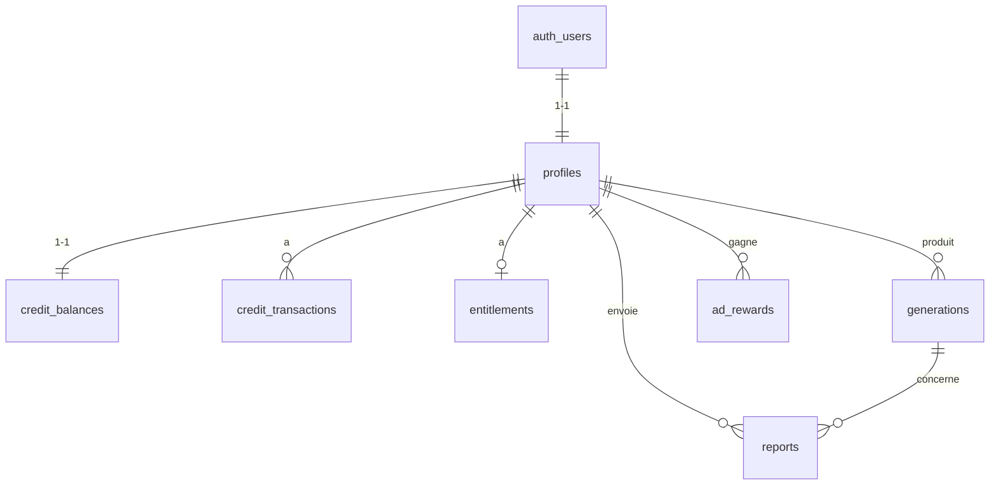

# Modèle de données — Flirt Coach

> Phase 3 — Database Architect. Base de développement : Supabase local sous Docker (ADR-009).
> Les tables sont créées par l'incrément qui les utilise ; la colonne « Inc » l'indique.

## Dictionnaire

| Table | Inc | Colonnes principales | Rôle |
|-------|-----|----------------------|------|
| `profiles` | 0 | `id` (= `auth.users.id`), `age_confirmed_at`, `created_at`, `updated_at` | Compte ; `created_at` sert à l'offre J+3 |
| `credit_balances` | 1 | `user_id`, `daily_credits`, `daily_reset_on` (date UTC), `bonus_credits` | Solde courant |
| `credit_transactions` | 1 | `id`, `user_id`, `amount`, `kind`, `reference`, `created_at` | Journal immuable des mouvements |
| `entitlements` | 1 (écrit en 5) | `user_id`, `is_premium`, `product_id`, `expires_at` | Droits Premium |
| `generations` | 1 | `id`, `user_id`, `kind`, `style`, `input_text`, `output` (jsonb), `created_at` | Historique + base des signalements + plafond Premium |
| `message_bank` | 8 | `id`, `category`, `body`, `sort_order` | Contenu statique |
| `reports` | 10 | `id`, `user_id`, `generation_id`, `proposal_text`, `reason`, `created_at` | Signalements |
| `ad_rewards` | 6 | `id`, `user_id`, `transaction_id` (unique), `created_at` | Récompenses pub (anti-rejeu) |

Types énumérés : `generation_kind` (reply, opener, flirt, follow_up, pre_date, apology,
soft_breakup, screenshot, respect_check, conversation_analysis) · `credit_kind` (daily_use,
bonus_use, refund, purchase, ad_reward) · `report_reason` · `bank_category`.

## Règles d'accès (RLS activée partout)

| Table | Client (`authenticated`) | Écriture |
|-------|--------------------------|----------|
| `profiles` | lit sa ligne | trigger à l'inscription ; `confirm_age()` |
| `credit_balances`, `credit_transactions`, `entitlements` | lit ses lignes | Edge Functions uniquement (`service_role`) |
| `generations` | lit ses lignes si Premium ; supprime les siennes | Edge Function |
| `message_bank` | lecture pour tous les connectés | migrations |
| `reports` | insère et lit les siens | client (insert borné par policy) |
| `ad_rewards` | aucune | Edge Function |

Fonctions SQL `security definer` réservées au `service_role` (droit d'exécution retiré aux
rôles clients) : `consume_credits(user, cost)`, `refund_credits(user, cost)`,
`grant_credits(user, amount, kind, reference)`. Elles verrouillent la ligne de solde, remettent
les crédits du jour à 5 si la date a changé, puis débitent le jour avant le bonus.

## Conservation des données

- Captures d'écran : jamais écrites (ADR-006). `input_text` est nul pour `kind = screenshot`.
- `generations` d'un compte non Premium : purgées après 30 jours (tâche planifiée, Inc-9).
- Suppression de compte : `on delete cascade` depuis `auth.users` sur toutes les tables.

## Index

`generations (user_id, created_at desc)` (historique, plafond journalier) ·
`credit_transactions (user_id, created_at desc)` · `reports (generation_id)`.
