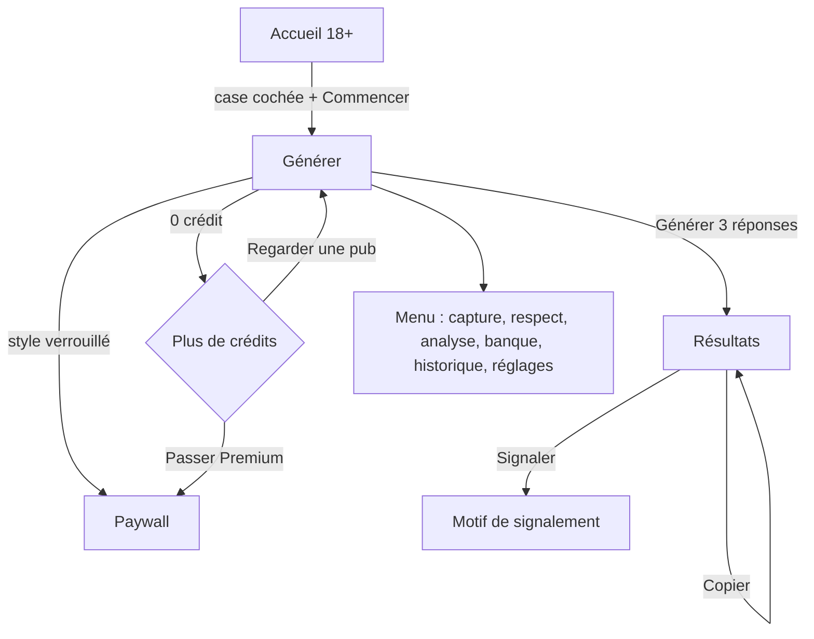

# Parcours et écrans — Flirt Coach

> Phase 3 — UI/UX. Les 3 écrans du kit de marque servent de maquettes ; ce document fixe le
> contenu et les états. Écarts au kit : pas de « Améliore ton profil » (ADR-007), « Drôle »
> verrouillé (INTAKE §2.3).

## Parcours principal



## Écrans

### Accueil 18+ (`/welcome`) — Inc-0
```
        [logo]
      Flirt Coach
Coach de drague et messages

 ✓ Trouve les bons mots
 ✓ Flirte avec respect
 ✓ Gagne en confiance

 ☐ J'ai 18 ans ou plus
 Les réponses sont des suggestions générées par
 IA. Aucun résultat n'est garanti.
 Confidentialité · Conditions

       [ Commencer ]
```
États : bouton désactivé tant que la case est décochée · chargement dans le bouton ·
erreur réseau sous le bouton, bouton redevenu actif pour réessayer.

### Générer (`/`) — Inc-1, Inc-2
```
 ☰                         [● 5 crédits]
        Générer un message
 [ situation : Répondre ▾ ]
 ┌───────────────────────────────────┐
 │ Colle son dernier message…     🖼 │
 └───────────────────────────────────┘
 Choisis un style
 [Classique] [Drôle 🔒] [Romantique 🔒]
 [Mystérieux 🔒] [Direct 🔒] [Élégant 🔒]
 [Provocateur léger 🔒]
        [ ✨ Générer 3 réponses ]
 (bannière publicitaire — gratuits)
```
États : bouton désactivé si champ vide · chargement · erreur (réseau, refus de modération,
crédits insuffisants → feuille « Plus de crédits »).

### Résultats (`/results`) — Inc-1
3 `ProposalCard` (texte, Copier, Signaler) · mention « Suggestions IA, aucun résultat
garanti » · « Régénérer » (1 crédit). Copier → confirmation brève.

### Paywall (`/paywall`) — Inc-5
Avantages Premium · 3 offres (hebdo mise en avant, mensuel, annuel « meilleur prix ») ·
prix lus depuis le store · mentions de renouvellement · « Restaurer mes achats » · packs de
crédits en dessous. Variante J+3 : annuel remisé en tête.

### Capture (`/screenshot`) — Inc-4
Choisir une image → aperçu → style → « Générer (2 crédits) ». Mention « Ta capture n'est pas
conservée ».

### Mode Respect (`/respect`) — Inc-3
Champ « Ton message » → verdict (OK / À revoir + raisons) → alternative proposée + Copier.

### Analyse (`/analysis`) — Inc-7
Gratuit : écran verrouillé + « Passer Premium ». Premium : coller la conversation →
progression, prochaine étape, idée de rendez-vous si pertinent.

### Banque (`/bank`) — Inc-8 · Historique (`/history`) — Inc-9
Onglets par catégorie, liste, Copier. Historique : liste paginée, suppression ; vide →
« Tes messages générés apparaîtront ici ».

### Réglages (`/settings`) — Inc-10
Compte (rattacher un e-mail, supprimer) · abonnement (gérer, restaurer) · confidentialité,
conditions, préférences publicitaires · contact.
