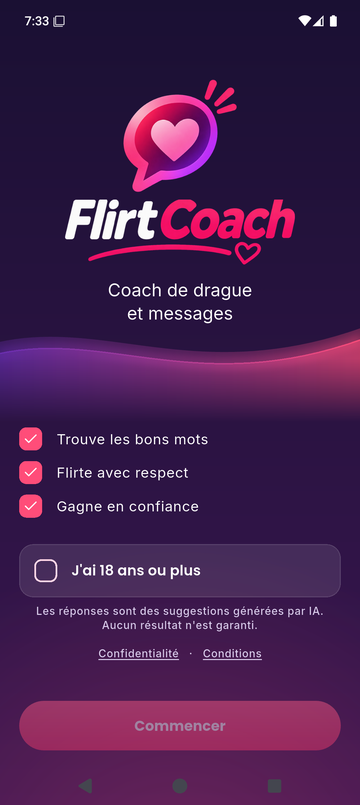
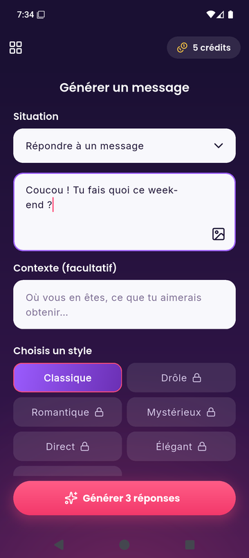
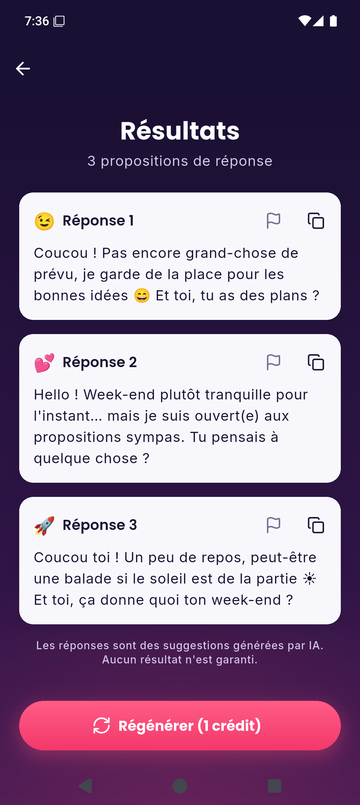
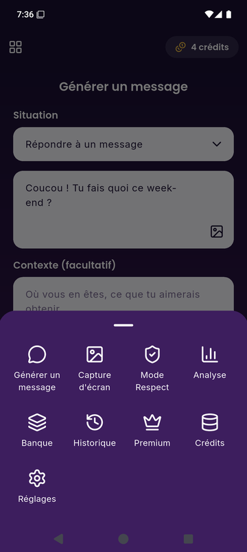
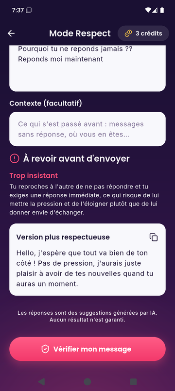
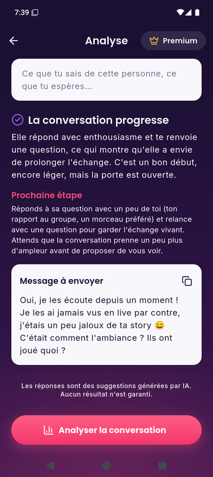
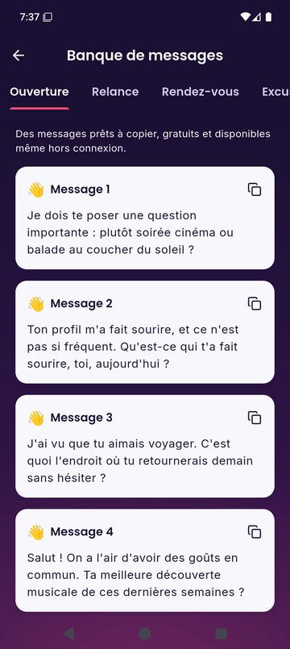
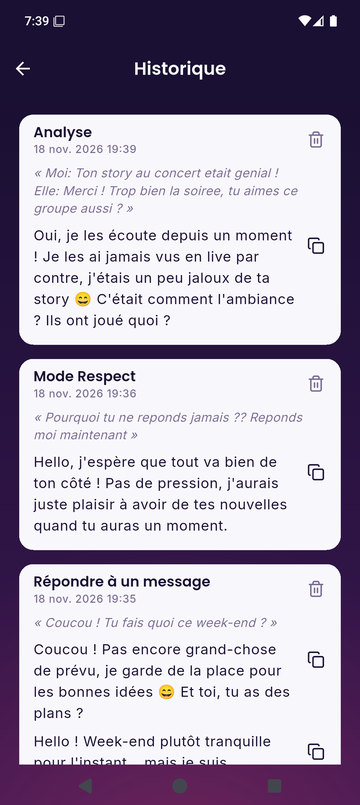
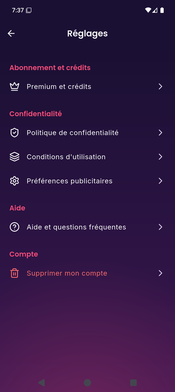
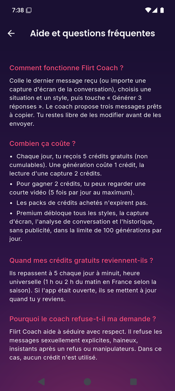

# Guide utilisateur

Comment utiliser Flirt Coach, fonctionnalité par fonctionnalité. Ce guide sert de référence au
support et de base aux textes des stores ; l'aide intégrée à l'app (Réglages → « Aide et
questions fréquentes ») en reprend l'essentiel.

**Sommaire** : [Premiers pas](#premiers-pas) · [Générer des réponses](#générer-des-réponses) ·
[Le menu](#le-menu) · [Capture d'écran](#répondre-à-partir-dune-capture-décran) ·
[Mode Respect](#mode-respect) · [Analyse](#analyse-de-conversation-premium) ·
[Banque](#banque-de-messages) · [Historique](#historique-premium) ·
[Crédits et Premium](#crédits-et-premium) · [Réglages](#réglages) ·
[Signaler](#signaler-une-réponse) · [Bon à savoir](#bon-à-savoir)

---

## Premiers pas

1. Ouvre l'app.
2. Coche **« J'ai 18 ans ou plus »** : Flirt Coach est réservé aux adultes.
3. Touche **« Commencer »**.

Aucune inscription : ni nom, ni e-mail, ni mot de passe. Un compte anonyme est créé sur ton
téléphone avec **5 crédits gratuits**. Les liens en bas de l'écran ouvrent la politique de
confidentialité et les conditions d'utilisation.

Aux lancements suivants, l'app s'ouvre directement sur l'écran « Générer un message ».

 

## Générer des réponses

1. **Situation** : choisis ce que tu veux faire (voir le tableau).
2. Pour « Répondre à un message », **colle le dernier message reçu**.
3. **Contexte (facultatif)** : ce que tu sais de la personne, où vous en êtes. Plus il est
   précis, plus les réponses sont personnelles.
4. **Style** : Classique est gratuit ; les six autres (Drôle, Romantique, Mystérieux, Direct,
   Élégant, Provocateur léger) sont inclus dans Premium.
5. Touche **« Générer 3 réponses »** (1 crédit).

Le solde de crédits est affiché en haut à droite ; le touchant ouvre l'écran Premium.

 

| Situation | Quand l'utiliser |
|-----------|------------------|
| Répondre à un message | tu as reçu un message et ne sais pas quoi répondre |
| Démarrer une conversation | premier message après un match |
| Flirter | faire monter la complicité |
| Relancer la conversation | la conversation s'est arrêtée |
| Avant un rendez-vous | confirmer, rassurer, donner envie |
| M'excuser | réparer une maladresse |
| Rompre en douceur | mettre fin avec respect |

### Les résultats

- **Copier** (icône à droite de chaque réponse) : la réponse est prête à coller dans ton
  application de messagerie. Tu peux toujours la modifier avant de l'envoyer.
- **Régénérer** : trois nouvelles propositions, au même coût que la demande d'origine (1 crédit,
  ou 2 pour une capture d'écran ; inclus avec Premium).
- **Drapeau** : signaler une réponse inappropriée.

Le coach répond **dans la langue de la conversation** : un message reçu en anglais donne des
réponses en anglais.

 

## Le menu

L'icône en haut à gauche de l'écran « Générer un message » ouvre le menu : Générer un message,
Capture d'écran, Mode Respect, Analyse, Banque, Historique, Premium, Crédits et Réglages.

 

## Répondre à partir d'une capture d'écran

Plutôt que de recopier la conversation, importe une capture : menu → **« Capture d'écran »**, ou
l'icône image dans le champ du message.

- Le coach lit la conversation visible et répond au dernier message de l'autre personne.
- Coût : **2 crédits** (inclus avec Premium). Si la capture est illisible, aucun crédit n'est
  utilisé.
- La capture n'est **jamais conservée** : elle sert uniquement à proposer les réponses.
- Conseil : une capture nette, sans zoom, où l'on voit les bulles des deux personnes.

## Mode Respect

Avant d'envoyer un message, vérifie qu'il n'est pas **trop insistant**, **trop sexualisé** ou
**manipulateur**.

1. Menu → **« Mode Respect »**.
2. Écris ou colle ton message ; ajoute le contexte si besoin (messages restés sans réponse…).
3. Touche **« Vérifier mon message »** (1 crédit, inclus avec Premium).

Résultat : « Ton message est respectueux » ou « À revoir avant d'envoyer », avec l'explication
de chaque point et une **version plus respectueuse** prête à copier.

 

## Analyse de conversation (Premium)

Colle votre échange (qui dit quoi) ou importe une capture, puis touche **« Analyser la
conversation »**. Le coach indique :

- si la conversation **progresse**, **stagne** ou **recule**, et pourquoi ;
- la **prochaine étape** à suivre ;
- un **message à envoyer** ;
- une idée de **rendez-vous**, quand le moment s'y prête.

 

## Banque de messages

Des messages prêts à copier, **gratuits**, classés en cinq catégories : Ouverture, Relance,
Rendez-vous, Excuses, Rupture douce. Après une première ouverture, la banque reste consultable
**sans connexion**.

 

## Historique (Premium)

Toutes tes générations, analyses et vérifications, de la plus récente à la plus ancienne.

- Copie à nouveau une réponse avec l'icône de copie.
- Supprime une entrée avec l'icône corbeille, puis confirme : elle est effacée définitivement.
- « Afficher plus » charge les entrées plus anciennes.

 

## Crédits et Premium

### Version gratuite

| Action | Coût |
|--------|------|
| Générer 3 réponses, ou les régénérer | 1 crédit |
| Vérifier un message (Mode Respect) | 1 crédit |
| Répondre à partir d'une capture, ou régénérer ces réponses | 2 crédits |
| Banque de messages | gratuite |

- **5 crédits offerts chaque jour**, remis à 5 à minuit heure universelle (1 h ou 2 h du matin
  en France). Ils ne se cumulent pas d'un jour à l'autre.
- Crédits épuisés : le bouton **« Regarder une pub (+2 crédits) »** apparaît (5 vidéos par jour
  au plus), à côté de « Passer Premium ».
- **Packs de 20, 50 ou 100 crédits** : achat unique, sans abonnement, **sans date
  d'expiration**. Les crédits du jour sont utilisés en premier.
- Une bannière publicitaire discrète, en bas des écrans Générer et Mode Respect, finance la
  version gratuite.

### Premium

Abonnement hebdomadaire, mensuel ou annuel, depuis le menu → « Premium » :

- les 7 styles ;
- capture d'écran, Mode Respect et régénérations sans crédits ;
- analyse de conversation et historique ;
- aucune publicité ;
- jusqu'à 100 générations par jour (limite d'usage raisonnable).

L'abonnement est renouvelé automatiquement au prix indiqué. Il se **résilie dans le store**, au
plus tard 24 h avant le renouvellement : Réglages → « Gérer mon abonnement ». Après une
réinstallation ou sur un nouveau téléphone, « Restaurer mes achats » (écran Premium) récupère
l'abonnement ([détail](#changer-de-téléphone)).

## Réglages

| Section | Contenu |
|---------|---------|
| Abonnement et crédits | Premium et crédits · Gérer mon abonnement (abonnés Premium) |
| Confidentialité | Politique de confidentialité · Conditions d'utilisation · Préférences publicitaires (quand la réglementation l'exige, par exemple dans l'UE) |
| Aide | Aide et questions fréquentes · Contacter le support |
| Compte | Supprimer mon compte |

 

**Supprimer mon compte** efface définitivement l'historique, les crédits et les signalements, puis
ramène à l'écran d'accueil. Un abonnement en cours **n'est pas résilié** pour autant : le faire
dans Google Play ou l'App Store.

**Préférences publicitaires** rouvre le choix du consentement (publicités personnalisées ou non).
L'app fonctionne de la même façon quel que soit le choix.

 

## Signaler une réponse

Sur l'écran Résultats, touche le **drapeau** de la réponse, puis choisis un motif : offensante
ou blessante, sexuelle ou déplacée, harcèlement ou insistance, manipulatrice, autre problème. Le
signalement aide à améliorer le coach.

## Bon à savoir

### Ce que le coach refuse

Flirt Coach aide à séduire avec respect. Il refuse les demandes sexuellement explicites,
haineuses, insistantes après un refus ou manipulatrices ; aucun crédit n'est alors utilisé.

### Sans connexion

| Disponible | Indisponible |
|------------|--------------|
| Banque de messages (après une première ouverture) | génération, capture, Mode Respect, analyse, historique, achats |

### Autorisations demandées

| Autorisation | Pourquoi | Quand |
|--------------|----------|-------|
| Photos | choisir une capture de conversation | aucune sur Android ni sur iOS 14 et plus : le sélecteur du système ne donne accès qu'à l'image choisie ; sur iOS 13, l'accès aux photos est demandé au premier import |
| Suivi publicitaire (iOS) | publicités plus pertinentes | une fois ; refuser ne change rien au fonctionnement |
| Consentement publicitaire (UE) | obligation RGPD | avant la première publicité ; modifiable dans Réglages → « Préférences publicitaires » |

### Données personnelles

- Aucun nom ni e-mail demandé.
- Les captures ne sont jamais conservées.
- L'historique n'est visible que par toi et disparaît avec ton compte.
- Détails : Réglages → « Politique de confidentialité ».

### Changer de téléphone

1. Installer Flirt Coach sur le nouveau téléphone et confirmer son âge.
2. Écran Premium → « Restaurer mes achats », avec le même compte Google Play ou Apple.
3. Premium s'active en quelques secondes : « Achats restaurés : Premium est actif. ». Si le
   serveur met un peu plus de temps, l'app l'indique et Premium apparaît peu après.

L'abonnement passe sur la nouvelle installation ; l'ancienne le perd. Les crédits achetés et
l'historique restent liés à l'ancienne installation et ne se transfèrent pas.
