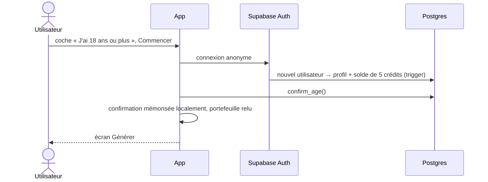
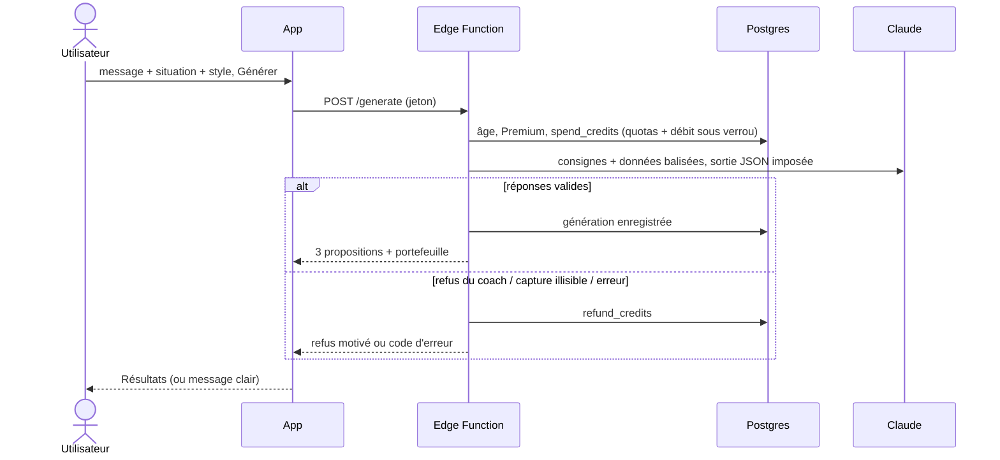
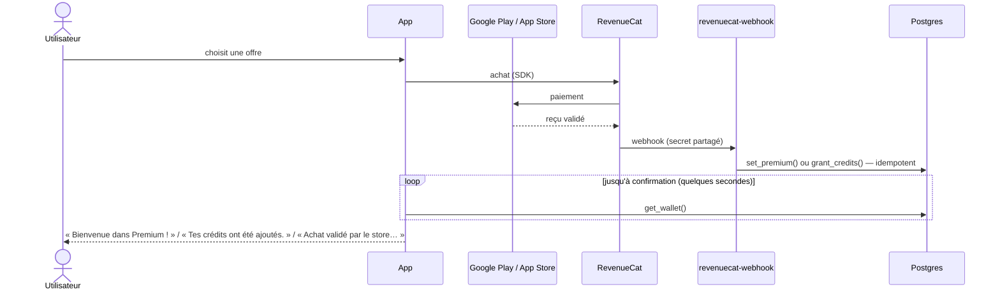
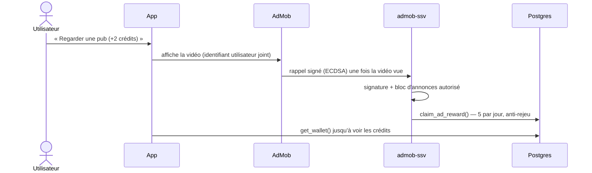
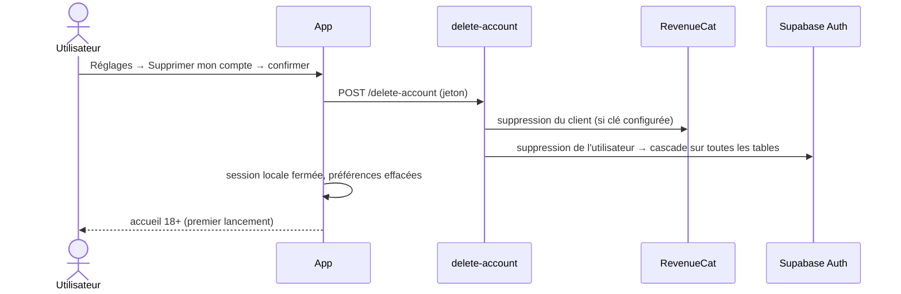
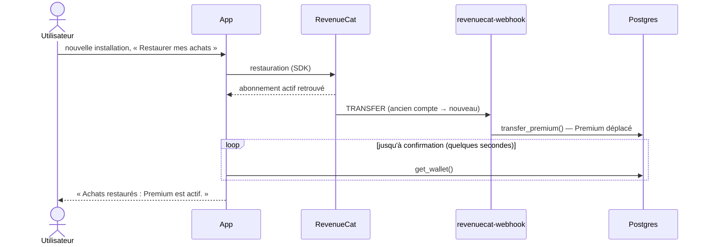

# Flux principaux

Séquences des parcours critiques, telles qu'implémentées. Complète
[`architecture.md`](architecture.md) (structure) et [`api-reference.md`](api-reference.md) (contrats).

## 1. Premier lancement

Les lancements suivants ouvrent directement l'écran Générer (session dans le Keychain/Keystore).
Sans réseau au premier lancement, rien n'est mémorisé et « Commencer » peut être relancé.

## 2. Génération (et Mode Respect, capture, analyse)

Un double tap est ignoré par l'app ; deux requêtes simultanées sont comptées une à une par le
verrou du portefeuille côté serveur.

## 3. Achat (abonnement ou pack)

L'app n'accorde jamais un droit elle-même : elle attend que le serveur l'ait reçu. Un
remboursement passe par le même webhook (Premium retiré, crédits restants repris).

## 4. Vidéo récompensée

## 5. Suppression du compte

Un abonnement en cours n'est pas résilié par cette opération (l'utilisateur en est informé
avant de confirmer) : il se gère dans le store.

## 6. Restauration sur un nouveau téléphone

La nouvelle installation a un nouveau compte anonyme : l'abonnement la suit, l'ancien compte perd
Premium. Si le store ne trouve aucun abonnement actif, l'app répond tout de suite « Aucun
abonnement actif à restaurer pour ce compte store. » ; si le serveur tarde, elle l'indique
(« Abonnement retrouvé : Premium s'active dans quelques instants. »).
