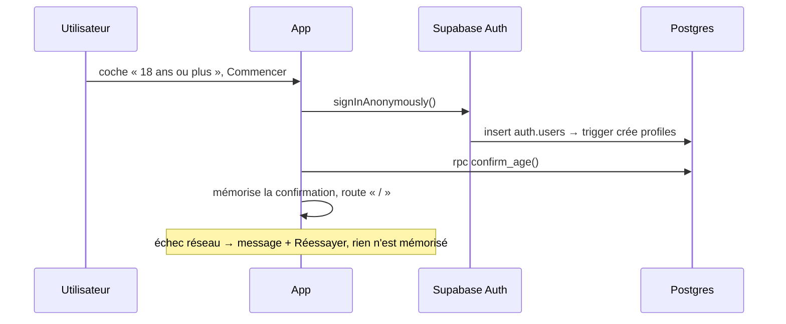
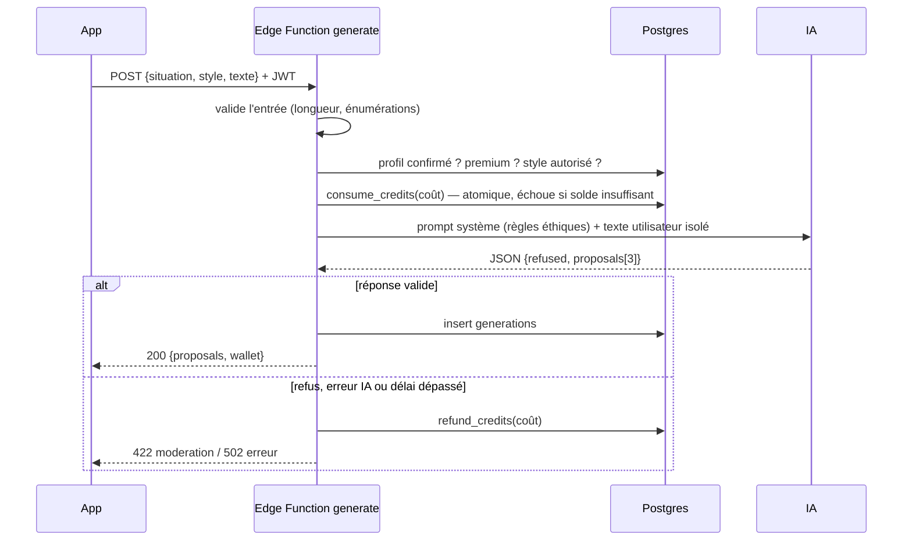

# Conception détaillée — Flirt Coach

> Phase 3 — System Design. Le domaine ne connaît pas Supabase : il ne voit que ces contrats.

## Erreurs typées

`Failure` (classe scellée) : `NetworkFailure` · `InsufficientCreditsFailure` ·
`PremiumRequiredFailure` · `ModerationFailure` (demande refusée) · `DailyLimitFailure` ·
`UnreadableImageFailure` · `UnexpectedFailure`. Chaque écran traduit un `Failure` en message
utilisateur ; aucun message technique brut n'est affiché.

## Contrats des repositories

```dart
abstract interface class AuthRepository {
  bool get hasSession;
  Future<void> signInAnonymously();          // sans effet si une session existe
  Future<void> confirmAge();                 // RPC confirm_age()
  Future<void> linkEmail(String email);      // Inc-10
  Future<void> deleteAccount();              // Inc-10, Edge Function
}

abstract interface class GenerationRepository {            // Inc-1 → Inc-4, Inc-7
  Future<GenerationResult> generate(GenerationRequest request);
  Future<GenerationResult> replyToScreenshot(Uint8List image, MessageStyle style);
  Future<RespectVerdict> checkRespect(String draft);
  Future<ConversationAnalysis> analyze(String conversation);
}

abstract interface class WalletRepository {                // Inc-1, Inc-5, Inc-6
  Future<Wallet> fetch();      // crédits du jour, crédits bonus, isPremium
}

abstract interface class HistoryRepository {               // Inc-9
  Future<List<Generation>> page({DateTime? before, int limit = 20});
  Future<void> delete(String id);
}

abstract interface class MessageBankRepository {           // Inc-8
  Future<List<BankMessage>> byCategory(BankCategory category);
}

abstract interface class ReportRepository {                // Inc-10
  Future<void> report({required String proposal, required ReportReason reason, String? generationId});
}
```

Entités freezed : `GenerationRequest(situation, style, receivedMessage?, context?)`,
`GenerationResult(id, proposals[3], wallet)`, `Wallet(daily, bonus, isPremium)`.

## Flux critique 1 — premier lancement



## Flux critique 2 — génération



Le débit précède l'appel IA (sinon deux requêtes simultanées dépensent le même crédit) et
est remboursé en cas d'échec. Premium : pas de débit, mais compteur journalier (plafond 100).

## Résilience

| Sujet | Règle |
|-------|-------|
| Délai | 30 s côté app pour une génération ; 25 s côté fonction vers l'IA |
| Nouvelle tentative | aucune automatique sur une génération (éviter un double débit) ; l'utilisateur relance |
| Idempotence | achats et récompenses identifiés par l'identifiant de transaction (contrainte `unique`) |
| Pagination | historique par curseur (`created_at`), 20 par page |
| Realtime | non utilisé ; le portefeuille est renvoyé par chaque réponse et relu à l'ouverture |

## Sécurité du prompt

Le texte collé et le contenu d'une capture sont transmis comme données délimitées, jamais
concaténés aux consignes. Le modèle n'a aucun outil. La sortie doit respecter un schéma JSON
strict ; toute sortie non conforme est traitée comme une erreur (remboursement).
